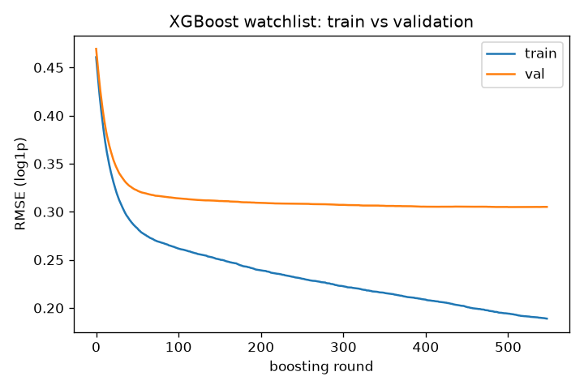
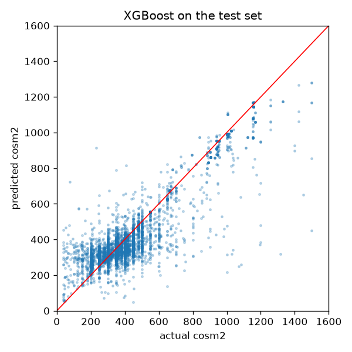
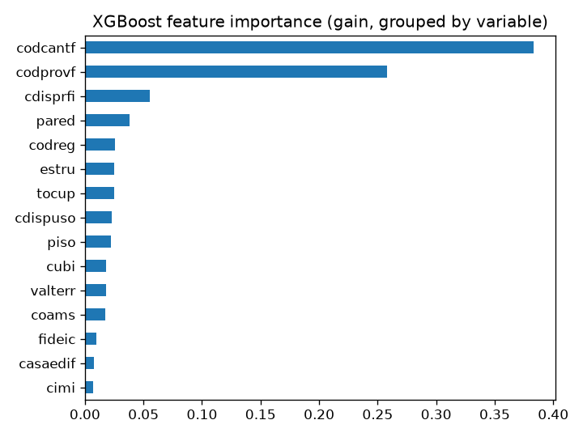

# Construction cost per m² in Ecuador (ESED 2025)


## Problem description

Municipal governments in Ecuador issue construction permits and report them to the national
statistics office (INEC) through the Building Statistics survey (ESED, *Estadísticas de
Edificaciones*). Each record describes a planned building: its location, materials, size,
use and financing, along with an estimated construction cost.
This project uses the 2025 annual dataset: 23,334 permits and 50 variables.
Source: https://www.ecuadorencifras.gob.ec/edificaciones/

**Goal.** Predict the estimated construction cost per square meter (`cosm2`, in US dollars)
from the characteristics of the building. This is a supervised regression problem.

**Scope.** Only new constructions and extensions are used (22,398 permits). Reconstructions
are excluded because the cost per square meter is not recorded for that type of work
(it is stored as 0).

**Intended use.** Give an initial reference of the cost per square meter to someone
preparing a construction project, before a formal budget is available. A web service
receives the characteristics of the building and returns the estimated cost.

**Limitations.** `cosm2` is the cost *declared in the permit*, not the actual cost of the
work. In addition, about half of the records share only seven round values (300, 350, 400,
415, 450, 480 and 500). One canton (code `1701`) reports 415 for every permit, while the
other repeated values are common across many cantons. The model should therefore be read
as a rough reference, not as a budget.

## Dataset

- Files, included in `data/` and unmodified: `6__2025_ESED_BDD.csv` (data) and
  `8__2025_ESED_Diccionario_variables.xlsx` (data dictionary). Original source: INEC (link above).
- One row per permit issued in 2025. The CSV is semicolon-separated, UTF-8 with a BOM.
- Column names are lowercased (the INEC dictionary uses `COSM2`, `CARES`...).
- Reconstructions (`ctipobr = 3`, 936 rows, all with `cosm2 = 0`) are removed:
  19,939 new constructions and 2,459 extensions remain.
- Data handling worth knowing: province and canton codes are read as strings to keep
  leading zeros; coded columns are treated as categories, not numbers; `nucucal` and `nudocal`
  are blank for non-residential buildings (not applicable) and are filled with 0.

**Features (37).** Location (`codreg`, `codprovf`, `codcantf`, `careaur`), materials
(`cimi`, `piso`, `estru`, `entrepisos`, `pared`, `cubi`), size and shape (`cares`, `carnres`,
`csute`, `caesv`, `carpat`, `nupical`, `cperm`, `cnuvical`), use (`ctipobr`, `cdispuso`,
`cores`, `coams`, `tocup`, `casaedif`, `nucucal`, `nudocal`), financing (`cdisprfi`,
`tipfinan`, `fideic`), surroundings and services (`espverd`, `asagua`, `asluz`, `asalcant`,
`cintern`, `astelf`, `aedif`) and `valterr`.

**Excluded variables.**
- `id` (identifier), `anio` (constant), `fper` (same information as `mes`), `mes`
  (administrative), `propie` (99.7% one category), `secredit` and `nuvisec` (near-constant).
- `cvae` (total declared value): `cvae / carco` almost reproduces the target, so it would leak the answer.
- `carco` (the sum of the area columns), `cdispsut` and `cdisparc` (ranges of other columns), and `cardpar` (non-zero in 9 rows).

## Exploratory data analysis

Full analysis in [`notebook.ipynb`](notebook.ipynb). It is done on train + validation only; the test set is never touched.

- **Target.** `cosm2` ranges from 40 to 1,500 with median 385. It is right-skewed (skew 1.81) and nearly
  symmetric after `log1p` (-0.36), so the models predict `log1p(cosm2)`.
  Only 66 rows (0.4%) are at or below 50; there is no natural cutoff, so they are kept.
  
- **Repeated values.** Seven values cover 48% of the permits. The 415 comes from a single canton
  (`1701`): all 1,069 of its permits report 415 and leave `espverd`, `tocup` and `cintern` at 0, so those
  three columns act as a proxy of that canton. The values 300, 350 and 400 are the dominant value in dozens
  of cantons.
- **Duplicates.** About 14% of the rows belong to groups of identical records (same date, canton, features and cost),
  almost all new single-dwelling permits in a few cantons. They could end up on both sides of a random split, so the
  notebook checks whether that inflates the validation score (see below): it does not in a measurable way.
- **Numeric features.** Areas are extremely skewed and only weakly correlated with the target (|Spearman| ≤ 0.18).
  `csute`/`caesv` (0.92) and `nucucal`/`nudocal` (0.78) are strongly correlated.
  
- **Categorical features.** Location is the strongest signal; costs differ clearly by region.
  Province `09` alone is 27% of the rows, and 110 of 217 cantons have fewer than 30 rows.
  
- **Feature importance.** Mutual information with the target puts `codcantf`, `codprovf`, the areas and the
  materials at the top; `propie`, `ctipobr` and `carnres` are close to the noise floor (computed with a shuffled target).
- **Reference baseline.** Predicting the median cost of the canton gives RMSE (log1p) = 0.395 on validation.

## Models

Data split with `train_test_split`: 60% train, 20% validation, 20% test (`random_state=1`).
Features are turned into dictionaries and one-hot encoded with `DictVectorizer`.
Metrics: RMSE on the `log1p` scale (the training scale), RMSE in USD and R².

**How the models are tuned and compared.**
- **5-fold cross-validation** (`KFold`, `random_state=1`) on train + validation tunes Ridge, the decision tree and XGBoost,
  and it compares all the models. Each fold fits its own `DictVectorizer`.
- **XGBoost **: the data goes into `xgb.DMatrix`, each candidate of `eta`, `max_depth` and
  `min_child_weight` is scored with `xgb.cv` (same 5 folds, early stopping, which also gives the number of trees), and the final
  parameters are trained with `xgb.train` and a train/validation watchlist. The deployed pipeline uses `XGBRegressor` with the same
  parameters.
- **The validation split** tunes the random forest, whose fits are much slower, and is used for the sanity experiments.
- The test set is never used for any choice. The grids are small on purpose (the project was run on a single CPU core).

| Model | Tuned parameters | RMSE (log1p), 5-fold CV | std across folds | RMSE (USD) | R² |
|---|---|---|---|---|---|
| Canton median (baseline) | none | 0.394 | 0.009 | 176.8 | 0.310 |
| Ridge | `alpha` = 0.1 (flat between 0.1 and 1) | 0.363 | 0.010 | 158.7 | 0.414 |
| Decision tree | `max_depth` = 10, `min_samples_leaf` = 5 | 0.342 | 0.017 | 124.8 | 0.478 |
| Random forest | `max_depth` = 20, `min_samples_leaf` = 1, `max_features` = 0.2, 200 trees (tuned on validation) | 0.305 | 0.014 | 104.2 | 0.587 |
| **XGBoost** | `eta` = 0.05, `max_depth` = 8, `min_child_weight` = 1, 592 trees (`xgb.cv`) | **0.304** | 0.013 | 107.0 | **0.588** |

XGBoost and the random forest are tied: the gap (0.001) is far below the fold-to-fold spread (0.014). In a tie XGBoost is deployed, because
its pickled pipeline is about 24 times smaller (3.0 MB against 73.5 MB), which matters for the repository and the Docker image.


**Test set** (models retrained on train + validation as `make_pipeline(DictVectorizer(), model)`, evaluated once):

| Model | RMSE (log1p) | RMSE (USD) | R² |
|---|---|---|---|
| Canton median (baseline) | 0.411 | 177.6 | 0.274 |
| Random forest | 0.319 | 105.4 | 0.563 |
| **XGBoost (deployed)** | **0.321** | **109.3** | **0.557** |

An RMSE of 0.32 on the log scale means a typical relative error of roughly 30-40% (a factor of about e^0.32 ≈ 1.4).


**What the experiments show**
- **Feature importance.** Canton (0.383) and province (0.258) together account for about 64% of the XGBoost gain; the financing
  origin (`cdisprfi`, 0.056) comes next, followed by the wall material (`pared`) and a group of region, structure and occupation columns.
  
- **Location.** Removing the canton raises the validation RMSE from 0.305 to 0.317, and removing the province as
  well to 0.322. Location matters, but the model is not just a lookup of the canton.
- **Canton `1701`.** The model is almost exact there (RMSE 0.02), because every permit has the same value. On all other rows it is 0.33.
- **Duplicates and the plain split.** The same XGBoost model was validated with random split and with a split that keeps identical
  rows together, for 6 seeds. The difference changes sign from seed to seed (mean -0.002, standard deviation 0.009), so the random split
  does not inflate the score in a measurable way.
- **Overfitting.** XGBoost fits the training split much better than the validation split (RMSE 0.19 against 0.31 at the last round), while the validation error still improves slowly.

## Project files

```
├── data/                       # original INEC files (data + dictionary)
├── images/                     # figures used in this README
├── notebook.ipynb              # data preparation, EDA, feature importance, model selection and tuning
├── train.py                    # trains the final pipeline and saves it to pipeline_v1.bin
├── predict.py                  # FastAPI service
├── predict_test.py             # sends one building to the running service
├── pipeline_v1.bin             # saved pipeline: DictVectorizer + XGBoost
├── pyproject.toml              # dependencies (uv)
├── uv.lock                     # exact versions
├── .python-version             # Python 3.11
└── Dockerfile
```

## How to run

The environment is managed with [uv](https://docs.astral.sh/uv/getting-started/installation/). Run everything from the repository root.

```bash
# 1. Environment: creates .venv with the exact versions of uv.lock (Python 3.11)
uv sync

# 2. Train: takes a few seconds, regenerates pipeline_v1.bin and prints the test metrics
uv run python train.py

# 3. Serve
uv run uvicorn predict:app --host 0.0.0.0 --port 8000
# interactive documentation: http://localhost:8000/docs

# 4. In another terminal, send a building to the service
uv run python predict_test.py
```

**Notebook.** `uv sync` also installs the development group (Jupyter, matplotlib). Open it with `uv run jupyter lab`.
Running it end to end takes about 15 minutes on a single core, mostly because of the random forest tuning and the cross-validation.

**Docker.** The image installs the locked versions with `uv sync --locked --no-dev`.

```bash
docker build -t construction-cost-m2 .
docker run -it --rm -p 8000:8000 construction-cost-m2
uv run python predict_test.py       # from the host
```

## API

`GET /health` returns `{"status": "ok"}`.

`POST /predict` takes the 37 features. Coded columns are strings (leading zeros matter: `"09"`, `"0901"`; integers are
accepted and converted), areas and counts are numbers, and `nucucal` / `nudocal` are optional (default 0).

```bash
curl -X POST http://localhost:8000/predict -H "Content-Type: application/json" -d '{
  "codreg": "3", "codprovf": "21", "codcantf": "2101", "careaur": "2",
  "cimi": "120", "piso": "152", "estru": "125", "entrepisos": "5", "pared": "126", "cubi": "135",
  "ctipobr": "1", "cores": "160", "coams": "0", "cdispuso": "1", "cdisprfi": "12",
  "espverd": "2", "asagua": "1", "asluz": "1", "asalcant": "1", "cintern": "1", "astelf": "1", "aedif": "5005",
  "tocup": "5011", "fideic": "2", "casaedif": "1", "tipfinan": "6002", "valterr": "1",
  "cares": 71, "carnres": 0, "csute": 360, "caesv": 289, "carpat": 0,
  "nupical": 1, "cperm": 1, "cnuvical": 1, "nucucal": 7, "nudocal": 2
}'
# {"cost_per_m2_usd": 280.48}
```

This is the first permit of the test set (taken without looking at the prediction), whose declared cost is 280 USD/m².
One example says little: the typical error is the one described above.

The service rejects (HTTP 422):
- reconstructions (`ctipobr = 3`);
- any coded value that does not appear in the training data (for example `codreg = 5`; for columns with few values, the response lists the valid ones);
- a canton that does not belong to the given province;
- negative areas or counts, unknown fields and missing fields.

Without this check an unseen code would silently become an all-zero one-hot row and the model would predict anyway, ignoring that column.
Only 1 of the 4,480 permits of the test set (a canton never seen in training) would be rejected.

## Reproducibility

- The data is in the repository and the random seed is fixed (`random_state=1`).
- Exact dependency versions are in `uv.lock`; the Python version is in `.python-version`.
- `train.py` reproduces the pipeline of the notebook exactly (same file, `pipeline_v1.bin`) and its test metrics (RMSE log1p 0.321, RMSE USD 109.3, R² 0.557).

## Limitations and next steps

- The target is a declared estimate, and part of it reflects each municipality's reporting practice rather than construction costs.
- Only 2025 permits are used; costs from other years are not comparable without adjusting for inflation.
- Codes that are not in the training data (including cantons) are rejected instead of falling back to a coarser estimate.
- The service does not check that the region matches the province (for example region 1 with province 09 is accepted).
- Tuning grids are small, and the random forest is tuned on the validation split rather than with cross-validation. With `max_depth` 3 and 4, `xgb.cv` reached the cap of 1,000 trees, so those two settings were not fully explored (the deeper trees won anyway).
- A wider search, or quantile regression to give a price range instead of a single value, could be tried.
- The service is not deployed to a cloud provider.

