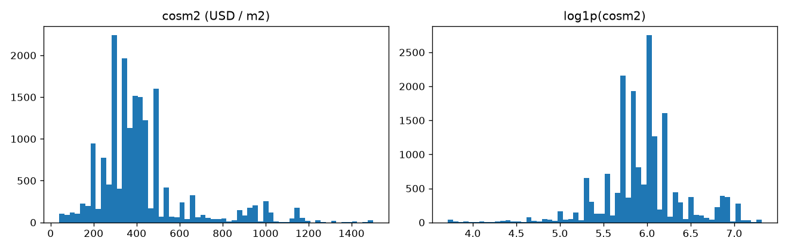
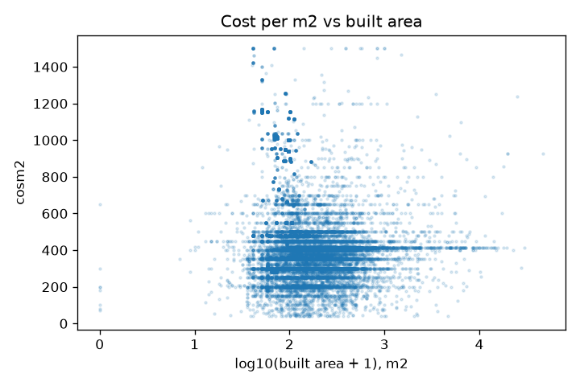
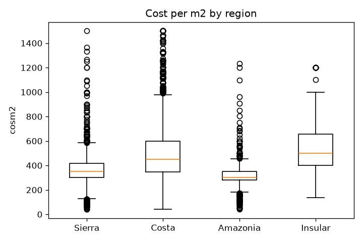

# Construction cost per m² in Ecuador (ESED 2025)

A regression model that estimates the declared construction cost per square meter of a building permit in Ecuador.

## Problem description

Municipal governments in Ecuador issue construction permits and report them to the national
statistics office (INEC) through the Building Statistics survey (ESED, *Estadísticas de
Edificaciones*). Each record describes a planned building: its location, materials, size,
use and financing, along with an estimated construction cost.
This project uses the 2025 annual dataset: 23,334 permits and 50 variables.
Source: https://www.ecuadorencifras.gob.ec/edificaciones/

**Goal.** Predict the estimated construction cost per square meter (`cosm2`, in US dollars)
from the characteristics of the building. This is a supervised regression problem.

**Scope.** Only new constructions and extensions are used (22,398 permits). Reconstructions
are excluded because the cost per square meter is not recorded for that type of work
(it is stored as 0).

**Intended use.** Give an initial reference of the cost per square meter to someone
preparing a construction project, before a formal budget is available. A web service
receives the characteristics of the building and returns the estimated cost.

**Limitations.** `cosm2` is the cost *declared in the permit*, not the actual cost of the
work. In addition, about half of the records share only seven round values (300, 350, 400,
415, 450, 480 and 500). One canton (code `1701`) reports 415 for every permit, while the
other repeated values are common across many cantons. The model should therefore be read
as a rough reference, not as a budget.

## Dataset

- Files, included in `data/` and unmodified: `6__2025_ESED_BDD.csv` (data) and
  `8__2025_ESED_Diccionario_variables.xlsx` (data dictionary). Original source: INEC (link above).
- One row per permit issued in 2025. The CSV is semicolon-separated, UTF-8 with a BOM.
- As in the course, column names are lowercased (the INEC dictionary uses `COSM2`, `CARES`...).
- Reconstructions (`ctipobr = 3`, 936 rows, all with `cosm2 = 0`) are removed:
  19,939 new constructions and 2,459 extensions remain.
- Data handling worth knowing: province and canton codes are read as strings to keep
  leading zeros; coded columns are treated as categories, not numbers; `nucucal` and `nudocal`
  are blank for non-residential buildings (not applicable) and are filled with 0.

**Features (37).** Location (`codreg`, `codprovf`, `codcantf`, `careaur`), materials
(`cimi`, `piso`, `estru`, `entrepisos`, `pared`, `cubi`), size and shape (`cares`, `carnres`,
`csute`, `caesv`, `carpat`, `nupical`, `cperm`, `cnuvical`), use (`ctipobr`, `cdispuso`,
`cores`, `coams`, `tocup`, `casaedif`, `nucucal`, `nudocal`), financing (`cdisprfi`,
`tipfinan`, `fideic`), surroundings and services (`espverd`, `asagua`, `asluz`, `asalcant`,
`cintern`, `astelf`, `aedif`) and `valterr`.

**Excluded variables.**
- `id` (identifier), `anio` (constant), `fper` (same information as `mes`), `mes`
  (administrative), `propie` (99.7% one category), `secredit` and `nuvisec` (near-constant).
- `cvae` (total declared value): `cvae / carco` almost reproduces the target, so it would leak the answer.
- `carco` (the sum of the area columns), `cdispsut` and `cdisparc` (ranges of other columns), and `cardpar` (non-zero in 9 rows).

## Exploratory data analysis

Full analysis in [`notebook.ipynb`](notebook.ipynb). It is done on train + validation only; the test set is never touched.

- **Target.** `cosm2` ranges from 40 to 1,500 with median 385. It is right-skewed (skew 1.81) and nearly
  symmetric after `log1p` (-0.36), so the models predict `log1p(cosm2)`, as in the course.
  Only 66 rows (0.4%) are at or below 50; there is no natural cutoff, so they are kept.
  
- **Repeated values.** Seven values cover 48% of the permits. The 415 comes from a single canton
  (`1701`): all 1,069 of its permits report 415 and leave `espverd`, `tocup` and `cintern` at 0, so those
  three columns act as a proxy of that canton. The values 300, 350 and 400 are the dominant value in dozens
  of cantons.
- **Duplicates.** About 14% of the rows belong to groups of identical records (same date, canton, features and cost),
  almost all new single-dwelling permits in a few cantons. They could end up on both sides of a random split, so the
  notebook checks whether that inflates the validation score (see below): it does not in a measurable way.
- **Numeric features.** Areas are extremely skewed and only weakly correlated with the target (|Spearman| ≤ 0.18).
  `csute`/`caesv` (0.92) and `nucucal`/`nudocal` (0.78) are strongly correlated.
  
- **Categorical features.** Location is the strongest signal; costs differ clearly by region.
  Province `09` alone is 27% of the rows, and 110 of 217 cantons have fewer than 30 rows.
  
- **Feature importance.** Mutual information with the target puts `codcantf`, `codprovf`, the areas and the
  materials at the top; `propie`, `ctipobr` and `carnres` are close to the noise floor (computed with a shuffled target).
- **Reference baseline.** Predicting the median cost of the canton gives RMSE (log1p) = 0.395 on validation.

## Models

Data split with `train_test_split` as in the course: 60% train, 20% validation, 20% test (`random_state=1`).
Features are turned into dictionaries and one-hot encoded with `DictVectorizer`.
Metrics: RMSE on the `log1p` scale (the training scale), RMSE in USD and R².

**How the models are tuned and compared.**
- **5-fold cross-validation** (`KFold`, `random_state=1`) on train + validation tunes Ridge, the decision tree and XGBoost,
  and it compares all the models. Each fold fits its own `DictVectorizer`.
- **XGBoost **: the data goes into `xgb.DMatrix`, each candidate of `eta`, `max_depth` and
  `min_child_weight` is scored with `xgb.cv` (same 5 folds, early stopping, which also gives the number of trees), and the final
  parameters are trained with `xgb.train` and a train/validation watchlist. The deployed pipeline uses `XGBRegressor` with the same
  parameters.
- **The validation split** tunes the random forest, whose fits are much slower, and is used for the sanity experiments.
- The test set is never used for any choice. The grids are small on purpose (the project was run on a single CPU core).

| Model | Tuned parameters | RMSE (log1p), 5-fold CV | std across folds | RMSE (USD) | R² |
|---|---|---|---|---|---|
| Canton median (baseline) | none | 0.394 | 0.009 | 176.8 | 0.310 |
| Ridge | `alpha` = 0.01 (flat between 0.01 and 3) | 0.363 | 0.010 | 158.7 | 0.414 |
